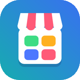
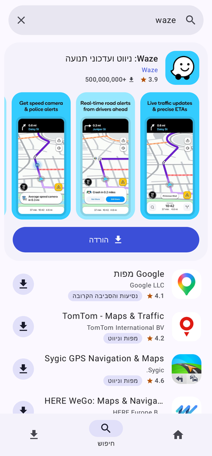
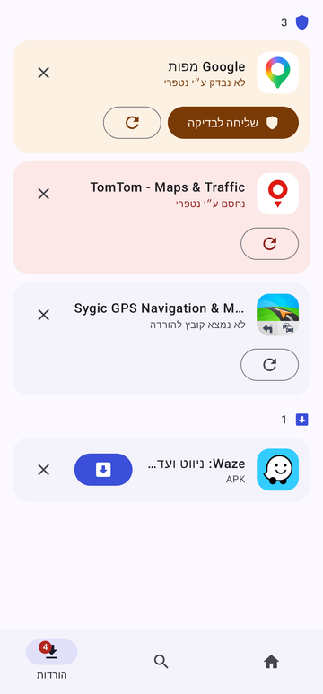
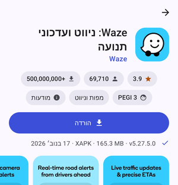
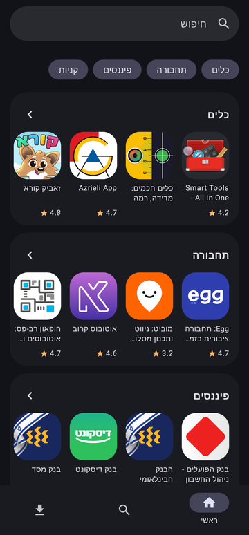
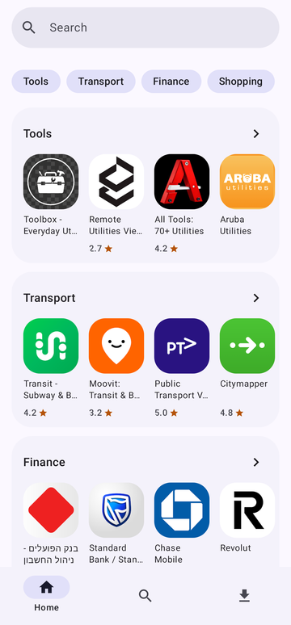

# חנות

חנות לאנדרואיד בסגנון גוגל פליי: מחפשים אפליקציה, רואים את כל המידע עליה, ומורידים אותה, גם מאחורי נטפרי.

  
  
  
  

## הורדה

**[⬇️ הורדת הגרסה האחרונה (apk-store.apk)](https://github.com/israel2176/win.apk-store/releases/latest/download/apk-store.apk)**

1. פותחים את הקישור בטלפון ומורידים את הקובץ.
2. פותחים את הקובץ שירד. אם אנדרואיד מבקש, מאשרים "התקנה ממקור לא ידוע" לדפדפן או למנהל הקבצים.
3. כשיוצאת גרסה חדשה, מורידים ומתקינים אותה באותה דרך. היא תתקין את עצמה מעל הקודמת.

כל הגרסאות, עם רשימת השינויים, נמצאות בדף [Releases](https://github.com/israel2176/win.apk-store/releases).

## מה אפשר לעשות

- **לחפש** כל אפליקציה שיש בגוגל פליי. ההתאמה המדויקת מופיעה ראשונה, ובגלילה נטענות עוד תוצאות.
- **לראות את דף האפליקציה:**
  - צילומי מסך ותיאור.
  - מה חדש בגרסה האחרונה.
  - דירוגים וביקורות, עם מיון לפי רלוונטיות, חדשות או דירוג.
  - בטיחות נתונים והרשאות.
  - פרטי המפתח ואפליקציות דומות.
- **להוריד ולהתקין** אפליקציות חינמיות.
- **לשלוח לבדיקה של נטפרי** קובץ שעוד לא נבדק, ישירות מהאפליקציה.

## איך מורידים אפליקציה

1. **מחפשים** את האפליקציה, או בוחרים אותה מהשורות שבדף הראשי.
2. **בודקים מה כתוב מתחת לכפתור "הורדה".** שם מופיע אם יש קובץ להורדה, ואם הוא מעודכן:

   | לא זמין להורדה | גרסה ישנה יותר | מעודכן |
   |:---:|:---:|:---:|
   |  |  |  |
   | אין קובץ, ואי אפשר להוריד דרך החנות | אפשר להוריד, אבל זו לא הגרסה האחרונה | הכל תקין |

3. **לוחצים על "הורדה"** (או "עדכון"). זהו: כמו בפליי, כשההורדה נגמרת האפליקציה מותקנת לבד. אם ההורדה נקטעת, היא מנסה שוב לבד.
4. **עוקבים במסך ההורדות.** כל אפליקציה מופיעה בצבע לפי המצב שלה:

   | צבע | מצב | מה עושים |
   |:---:|---|---|
   | 🟠 | לא נבדק ע״י נטפרי | לוחצים "שליחה לבדיקה". אחרי שנטפרי מאשר, לוחצים על החץ המעגלי כדי לנסות שוב. |
   | 🔴 | נחסם ע״י נטפרי | נטפרי בדק וחסם את הקובץ. |
   | ⚪ | נכשל | ההודעה מסבירה מה קרה. אפשר לנסות שוב. |
   | 🔵 | מוכן | הקובץ ירד וההתקנה לא הושלמה (נכשלה או בוטלה). לוחצים "התקנה" כדי לנסות שוב. |

5. **בפעם הראשונה** אנדרואיד מבקש לאשר "התקנה ממקור לא ידוע" לחנות. מאשרים, חוזרים, ולוחצים על "התקנה". (ב-Win.apk החנות המובנית לא צריכה את האישור הזה.)

## כדאי לדעת

- **אפליקציות בתשלום** מוצגות עם המחיר שלהן, ולא ניתנות להורדה. כך גם אפליקציות שעוד לא יצאו (הרשמה מוקדמת).
- **מקור הקבצים** הוא APKPure. לא כל אפליקציה קיימת שם, ולפעמים הגרסה שם ישנה מזו שבפליי. הדף מציג את זה מראש.
- **איזה קובץ יורד:** כמו בפליי, זה שמתאים למעבד של המכשיר (`Build.SUPPORTED_ABIS`, לפי הסדר). ב-Win.apk: גרסת x86_64 כשיש, אחרת arm64-v8a (ש-Win.apk מתרגם); לעולם לא armeabi-v7a או x86. APKPure לא אומר מה יש בכל קובץ, אז החנות קוראת את תוכן הקובץ (רק את רשימת הקבצים שבו) לפני ההורדה, כמו EFForg/apkeep#259.
- **משחקים גדולים** שמגיעים עם קבצי נתונים נוספים (OBB) עדיין לא מותקנים במלואם.
- **החנות היא הישראלית:** הזמינות והמחירים הם כמו בגוגל פליי בישראל.

## שפה ותצוגה

- **שפה:** האפליקציה בעברית או באנגלית, לפי שפת הטלפון. גם התיאורים והביקורות מפליי מגיעים בשפה הזו.
- **מצב כהה:** מופעל לבד, לפי הגדרת הטלפון.
- **מסך גדול:** בטאבלט ובטלפון לרוחב התפריט עובר לצד, ודף האפליקציה מתחלק לשני טורים.

  
  
  

