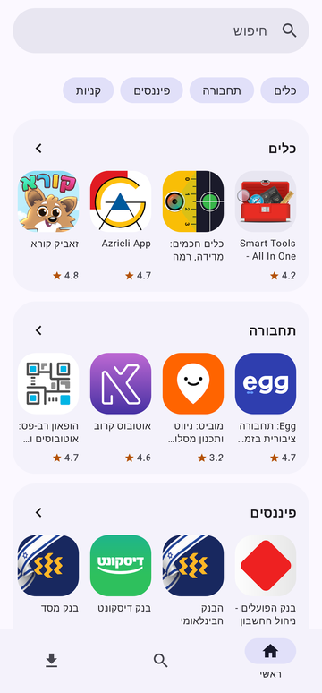
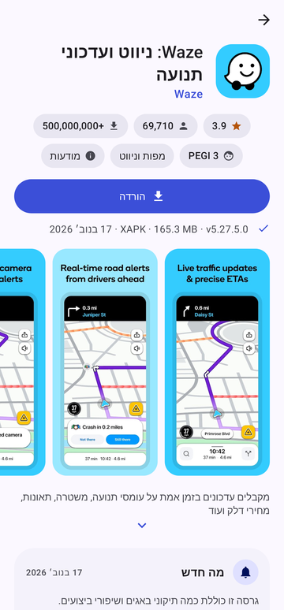
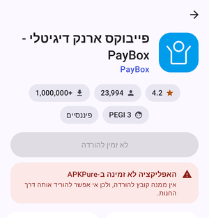
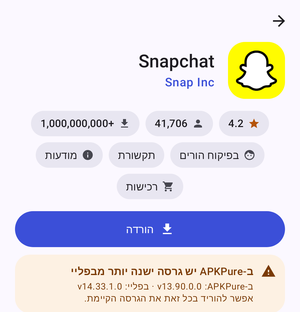
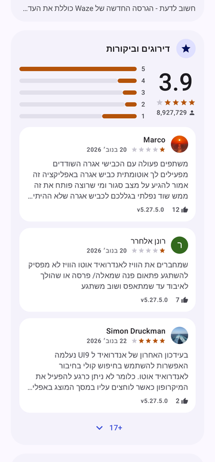
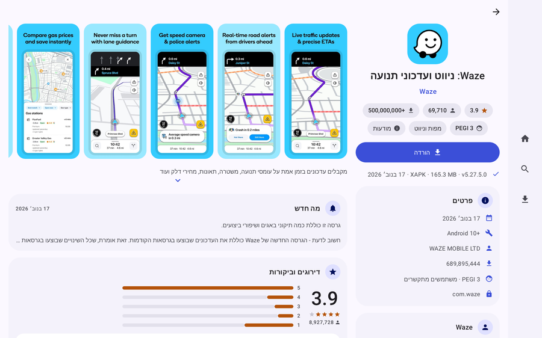

# חנות אפליקציות (Android)

חנות לאנדרואיד שמציגה את התוכן של גוגל פליי, מורידה את הקבצים מ-APKPure, ומטפלת בחסימות של נטפרי.

<p>
  
  
  
  
</p>

## יכולות

| | |
|---|---|
| **חיפוש** | תוצאות חיות מפליי. ההתאמה המדויקת מופיעה ראשונה, והרשימה ממשיכה להיטען בגלילה. |
| **דף אפליקציה** | צילומי מסך, תיאור, מה חדש, דירוגים, ביקורות (עם מיון), בטיחות נתונים, הרשאות, פרטים, פרטי המפתח ואפליקציות דומות. |
| **הורדה** | מ-APKPure, לפי שם החבילה. לפני ההורדה מוצג אם הקובץ זמין, ואם הגרסה בו ישנה מזו שבפליי. |
| **נטפרי** | דף חסימה מזוהה בכל בקשה. קובץ שלא נבדק מקבל כפתור "שליחה לבדיקה". |
| **התקנה** | APK רגיל, או XAPK שמכיל כמה קבצים. |
| **תצוגה** | טלפון, טלפון לרוחב וטאבלט, מצב בהיר וכהה, עברית ואנגלית לפי שפת המערכת. |

אפליקציה בתשלום, או כזו שעוד לא יצאה, מוצגת עם המחיר או עם "הרשמה מוקדמת", ולא מוצעת להורדה.

## זרימת עבודה

1. **מחפשים** אפליקציה, או בוחרים מהשורות בדף הראשי.
2. **בדף האפליקציה** רואים מתחת לכפתור ההורדה מה יש ב-APKPure:

   | לא זמין | גרסה ישנה יותר | מעודכן |
   |:---:|:---:|:---:|
   |  |  |  |

3. **מורידים.** ההורדה מנסה שוב עד פעמיים אם ההעברה נקטעה.
4. **במסך ההורדות** כל פריט מופיע לפי המצב שלו:
   - 🟠 **לא נבדק ע״י נטפרי:** שולחים לבדיקה, ואחרי האישור לוחצים על "נסה שוב".
   - 🔴 **נחסם:** נטפרי בדק וחסם את הקובץ.
   - ⚪ **נכשל:** ההודעה מסבירה למה.
   - 🔵 **מוכן:** מתקינים.

   "נסה שוב" תמיד מבקש קישור חדש, כי הקישורים של APKPure פגים אחרי זמן קצר.
5. **מתקינים.** בפעם הראשונה אנדרואיד מבקש לאשר התקנה ממקור לא מוכר.

## מסכים נוספים

<p>
  
  
  
</p>


## מבנה הקוד

| קובץ | תפקיד |
|---|---|
| `data/PlayApi.kt` | חיפוש, דף אפליקציה וביקורות מ-play.google.com. הקוד תואם ל-[google-play-scraper](https://github.com/facundoolano/google-play-scraper). |
| `data/ApkPure.kt` | קישור ההורדה ופרטי הגרסה. זו אותה קריאה שעושה [apkeep](https://github.com/EFForg/apkeep). |
| `data/NetFree.kt` | זיהוי דף החסימה: `risk-type` (לא נבדק) או `deny` (נחסם). |
| `data/Downloads.kt` | ניהול ההורדות ושמירתן בין הפעלות. |
| `data/Errors.kt` | שגיאות שנשמרות כמזהה מחרוזת, כדי שיתורגמו לשפת הממשק. |
| `install/Installer.kt` | התקנה דרך PackageInstaller. |
| `ui/` | המסכים (`Screens.kt`, `AppPage.kt`), רכיבים, ערכת צבעים וגודל החלון. |
| `res/values*/strings.xml` | הטקסטים: אנגלית (ברירת מחדל) ועברית (`values-iw`). |

**כשגוגל משנה את מבנה הדף**, מעדכנים את הנתיבים ב-`PlayApi.kt`. כמה דברים כבר מטופלים שם באופן כללי:
- **פורמט JSPB:** כשמערך מתקצר, השדות הגבוהים עוברים לאובייקט שבסופו, תחת המפתח index+1.
- **איתור הנתונים:** לפי מזהה הבקשה (למשל `oCPfdb` לביקורות), ולא לפי המספר `ds:N`.
- **עומס:** בקשה שנכשלה בגלל עומס בפליי נשלחת שוב.

**השורות בדף הראשי** מוגדרות ב-`homeRows` שבקובץ `StoreViewModel.kt`. מילות החיפוש שלהן נמצאות בקבצי המחרוזות, כך שלכל שפה יש מילים משלה.

## בנייה

```bash
./gradlew assembleDebug
```

הקובץ נוצר ב-`app/build/outputs/apk/debug/app-debug.apk`. אפשר גם לפתוח את התיקייה ב-Android Studio.

## בדיקות

כל הבדיקות רצות מול פליי ו-APKPure החיים, ולכן הן דורשות אינטרנט.

```bash
./gradlew testDebugUnitTest
```

```bash
./gradlew recordRoborazziDebug
```

| בדיקה | מה נבדק |
|---|---|
| `PlayApiTest` | המקרים מהבדיקות של google-play-scraper: משחק, אפליקציה בתשלום, אפליקציה שלא קיימת, חיפוש בעברית, חיפוש בלי תוצאות, עמודים נוספים וביקורות. דוח מפורט נשמר ב-`app/build/outputs/play-report.txt`. |
| `ApkPureTest` | אפליקציה שקיימת, אפליקציה שחסרה, והשוואת גרסאות. |
| `ScreensTest` | צילומי מסך של כל המסכים בכמה גדלים, בעברית ובאנגלית. הם נשמרים ב-`app/build/outputs/roborazzi/`. |

אם Maven Central מחזיר שגיאה 429 בזמן הבדיקות, מגדירים `ROBOLECTRIC_REPO` לכתובת של מראה.

## הערות

- **תעודת נטפרי:** `network_security_config.xml` מאפשר תעודות משתמש, כדי שהחיבור יעבוד דרך התעודה של נטפרי.
- **מה לא מטופל עדיין:** קבצי OBB (בעיקר במשחקים) שנמצאים בתוך XAPK לא מותקנים.
- **חתימה:** גרסת שחרור נחתמת כרגע במפתח ה-debug.
